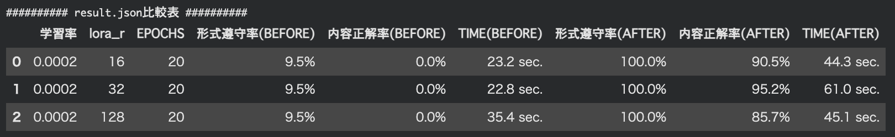
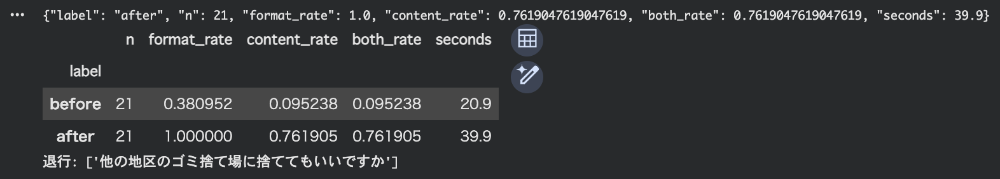
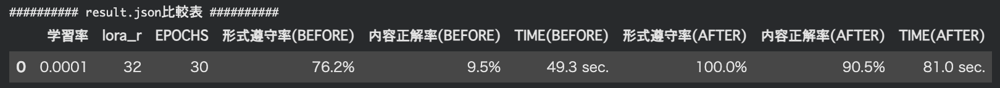

# 第2回 解答

## 演習

- 使ったモデル・設定（`result.json` の `config` から）：Qwen/Qwen3.5-0.8B
- 自分で学習を実行したか（`executed_training_myself`）：はい / いいえ（実行できた範囲：　はい）
- 学習前：`format_rate` =　 / `content_rate` =　0.09523809523809523 / 0.0
- 学習後：`format_rate` =　 / `content_rate` =　1.0 / 0.9047619047619048
- 退行した質問：なし
- 学習後に残った失敗と、その型（根拠なしの質問に断定した / 根拠ありの質問に確認要求で逃げた / 形式の崩れ）：FAQやGROUNDED（根拠あり）のデータが回答を一つに絞り込めるようにしないと、根拠なしの質問の内容が退行していた。
- 知識を問う質問（セクション 6）の結果（学習前の分類 → 学習後の分類）と気づいたこと：学習前は形式に従わずモデルのもつ表現力で逃げているが、学習後はLoRAの重みの形式を完全に遵守した回答に変わり、わからないと回答できるように変化していた。
- 学習で変わったこと・変わらなかったこと：型の遵守は100%になり、学習内容の型に重きをおいていた。型遵守によって、正解率も向上した。変わらなかった点は、わからないと答えずに回答を創作してしまう点。

## 宿題

- 取り組んだレベル：基礎
- 変えた設定やデータ：CONFIG['lora_r']を32と128に変更しました。
- 結果（比較表や数字）：


- ファインチューニングが向く場面・向かない場面についての考察：
CONFIGのパラメータについて、以下のように変更して調整を行いました。

1. lora_rの変更（16 → 32）
    - 演習データで不正解だった問題に対し、正解数が増加し、出力の形式遵守および内容正解率が向上しました（表現力の向上）。
2. lora_rの過剰な引き上げ（32 → 128）
    - さらに 128 まで上げたところ、かえって学習後の内容正解率が下がる現象が確認されました。これは表現力を過剰に高めたことによる過学習が進んだのでは？と考えました。結果から、適切なlora_rの値はデータの性質を見ながらチューニングする必要性を感じました。
3. 学習時間の影響
    - パラメータの規模を考慮してトレーニング時間を2倍に設定したものの、実行時間は多少増加した程度で、実用上ほとんど変わりませんでした（計算量の抑制と時間効率の良さ）。
> [!NOTE]
> 今回の検証を通じて、lora_r の調整によって学習パラメータ数が増加し、モデルの表現力向上や高い時間効率を得られることを実感しました。一方で、パラメータを高くすれば良いわけではなく、過剰な表現力はかえって回答精度の低下を招く可能性があることがわかりました。
> ここから、データの性質やモデルの性質に応じた適切なパラメータ設定の重要性を意識して検証を進めたいと思います。

---

- 取り組んだレベル：実装
- 変えた設定やデータ：FAQ/GROUNED/UNGROUNDEDなどデータをゴミ出しルールについてに変更（SYSTEMプロンプトも変更）しました。
- 結果（比較表や数字）：学習設定は共通設定とし、FAQなどのデータの修正によって、内容正解率が向上しました。  

#### 結果画像

データ修正前  
  
> 学習後に学習前からの退行が見られた。

データ修正後（result.json)  

> 学習後の退行も無くなり、正解率も向上しました。

1. **変更データ（FAQ・GROUNDED・UNGROUNDED等の修正）**
    > **UNGROUNDED（根拠なしデータ）の作成方法**
    >    - **生成AIの活用**: ゴミ出しの題材を与え、基本ルール（収集日・場所・袋・時間・祝日）には該当しない質問の作成を指示。
    >    - **根拠なし質問設計**: 以下の3要素を中心に根拠なし質問(UNGROUNDED)を作成しました。
    >        1. FAQに記載のない行政制度（粗大ゴミの申し込み、助成金など）
    >        2. 例外的な状況（大量ゴミ処分、地区外への捨て方など）
    >        3. 特殊な品目の個別ルール（スプレー缶、割れたガラスの処分など）
    >    - データ精査: AIが作成したデータとFAQを見比べ、創作やハルシネーションを起こさないより確実にわからない（needs_review: true）と回答できるかチェックと調整をおこない学習を繰り返しました。（例：ゴミ出しの時間と収集車が来る時間を指定しないなど）
    - データ修正前
        
        ```python
        # 宿題（実装）:[根拠なしを自分でどのように用意したのか？]
        # ゴミ出しのFAQデータ
        FAQ = {
            "schedule": "可燃ゴミは毎週火曜・金曜の朝 8:00 まで、不燃ゴミは毎月第2水曜日に出してください。",
            "location": "ゴミ捨て場は、各地区に設置されている専用の指定収集場所をご利用ください。",
            ...
        }
        ...
        # 根拠あり(正解あり): (FAQ キー, 質問テンプレート群, 正解の answer に含まれるべき語)
        GROUNDED = {
            ...
            "location": (["ゴミ捨て場はどこですか", "どこに出せばいいですか", "集積所の場所はどこで確認できますか", "指定の場所はどこですか"], ["指定収集場所", "各地区"]),
            ...
        }
        
        # 根拠なし(正解なし): FAQ に無いので needs_review=true が正解
        UNGROUNDED = [
            "粗大ゴミの申し込みはどうすればいいですか", "引っ越しで出た大量のゴミは一度に出せますか",
            "生ゴミ処理機の購入助成金はありますか", "他の地区のゴミ捨て場に捨ててもいいですか",
            "スプレー缶は中身を抜いてから出しますか", "割れたガラスの安全な捨て方を教えてください",
            "動物の死骸を見つけた場合はどう連絡しますか", "ボランティア清掃のゴミはどう回収されますか",
        ]
        ...
        ```
        
    - データ修正後
        
        ```python
        # ゴミ出しFAQ
        FAQ = {
            "schedule": "可燃ゴミは毎週火曜・金曜の朝8:00 まで、不燃ゴミは毎月第2水曜日に出してください。",
            "location": "ゴミ捨て場は、お住まいの地区に設置されている専用の指定収集場所をご利用ください。他の地区のゴミ捨て場を利用することはできません。",
            ...
        }
        ...
        
        # 根拠あり(正解あり)
        GROUNDED = {
            ...
            "location": (["ゴミ捨て場はどこですか", "どこに出せばいいですか", "集積所の場所はどこで確認できますか", "指定の場所はどこですか"], ["指定収集場所", "お住まいの地区"]),
            ...
        }
        
        # 根拠なし(正解なし): FAQ に無いので needs_review=true が正解
        UNGROUNDED = [
            ...
        ]
        ...
        ```

2. **LoRA学習設定(共通)**
    - **学習率 (learning_rate)**: `1e-4`
    - **LoRA Rank (lora_r)**: `32`
    - **Epochs**: `30`

3. **根拠なし（UNGROUNDED）」の質問について**

    生成AIにゴミ出しの題材を与え、FAQにはないデータを作成しました。基本的な収集日・場所・袋・時間・祝日の例外に限定されていることを指示し、プロンプトによって根拠なしデータの質問を用意した。

    1. FAQに記載のない行政制度（粗大ゴミの申し込み、助成金）
    2. 例外的な状況（大量ゴミ処分、地区外へのゴミ出し方法など）
    3. 特殊な品目の個別ルール（スプレー缶、割れたガラスなどの捨て方）

    > モデルが文章内に根拠のない質問に対してハルシネーションを起こさず、わからない（needs_review: true）と判定できるかを評価できるようなデータとしました。

- ファインチューニングが向く場面・向かない場面についての考察：

    1. **向く場面**
        - 短文・データ量も少なくて良いため、学習時間や計算効率がよい。
        - 短文の形式学習に向いており、出力形式の遵守や情報がない場合に定型文を返すといった形式的な振る舞いが特徴的です。
        - 学習時の形式に沿った内容や正解率の向上を効率よく達成できる点。また、FAQなどの短い文章で学習させた方が形式を学びやすい。
    2. **向かない場面**
        - タスクの形式や出力内容が変わる場合、都度再学習を行う必要がある点。
        - ベースとなるモデルが変更された場合に既存のLoRAの重みをそのまま使い回すことができず、再学習が必要になる点。
        - モデル自体に新たな知識を与える目的で拡張性がなく、出力の振る舞いの学習に適していると感じました。（LoRAでは応用的な回答は苦手に見えます）

> [!NOTE]
> 1. 生成AIから作成したデータで学習を行ったが、１回目の学習では、形式遵守率：100%,内容正解率が76.1〜80%でした。この結果から、学習前後のデータを比較し、内容不正解のFAQの問題を調査しました。結果、FAQやUNGROUNDのデータにLLMにとって迷いやすい構造があるとわかり、より具体的にキーワード指定し、２回目の学習をおこないました。２回目は、形式遵守：100%、正解率90%となったので、LoRAの学習設定も大事だが、データセットがLLMにとって明確に答えやすいデータにすることが適切に動作する条件につながると感じました。
> 2. １回目の学習前後の結果では、学習前より退行して回答したが、２回目のデータ修正によって、退行はなくなりました。データ修正ではカンニングではなく、質問に対して形式的に迷わず答えることを前提に取り組みました。
> 3. 今回の検証から、モデル自体に新しい知識を与えるものではなく、出力に対する形式遵守や根拠の有無の判定といったモデルの創作を制約する役割に向いていると感じました。
> 4. LoRAによるモデルの制約性能を活かし、わからないと確実に返すLoRAを模索したい。表現力が高く創作する生成を防ぐため、例外処理に特化したネガティブなサンプルを多く組み込んだファインチューニングを検証してみたいと考えている。
> 5. UNGROUNDEDデータは、FAQになく、LLMがみてわからないと考えられる適切なデータになっているかを修正時にとても悩みました。
