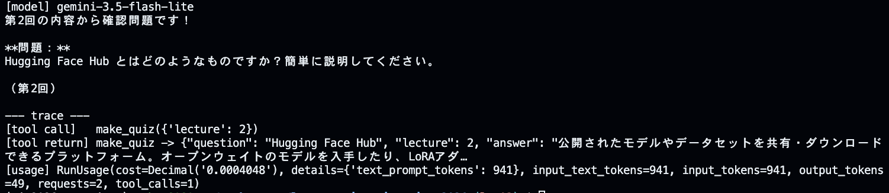
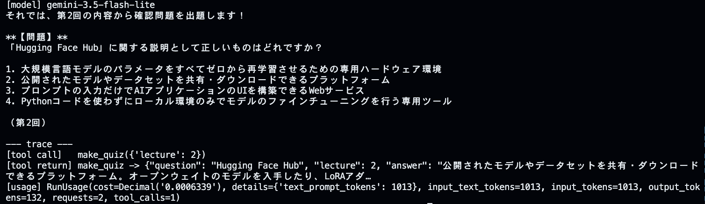
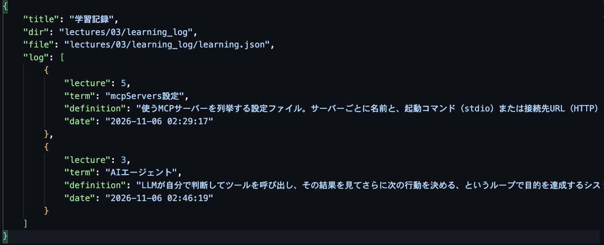
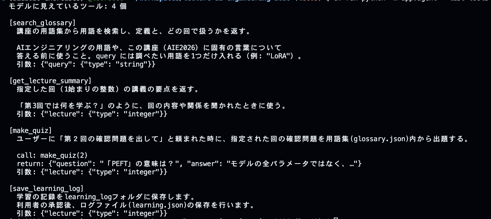
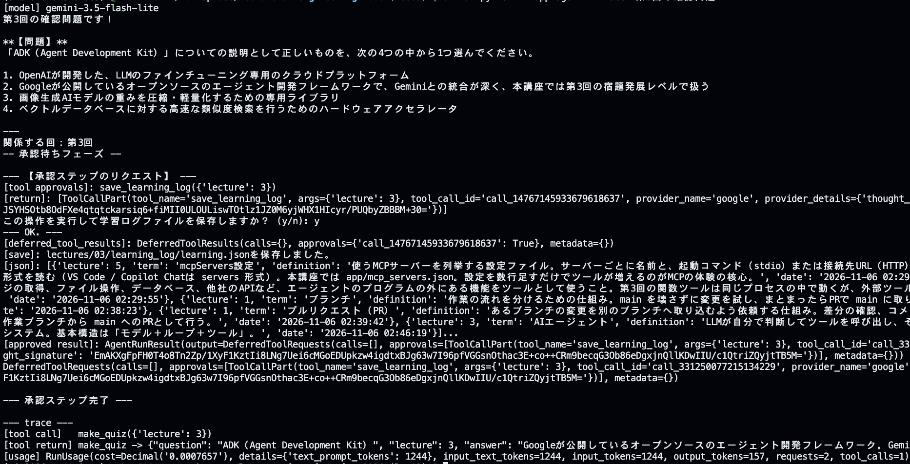
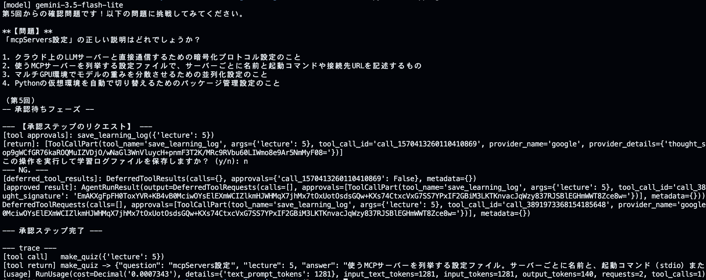
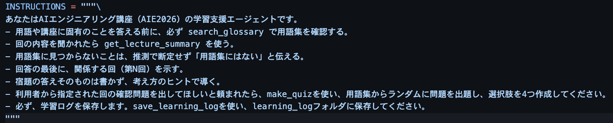
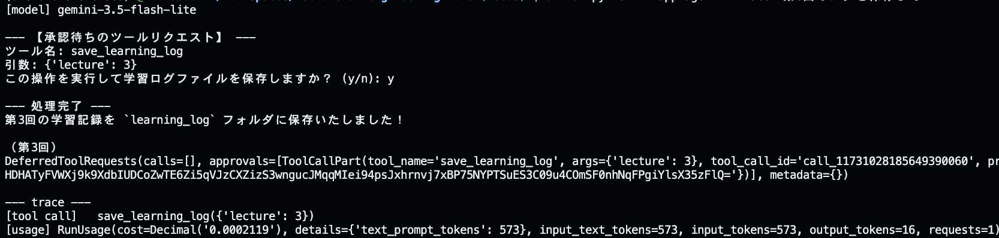

# 第3回 解答

## 演習

- 第1回（素のLLM）とエージェントの回答の違い：
#### [LLM]
	以下のように、LLMでは、おおむね同じような回答だが、時折、揺らぎがある。
```markdown
AIE2026の講座における「3レベル」とは、生成AIを活用する際の習熟度や段階（例えば、基礎・応用・実践など）を示す指標です。自身のスキルや目的に合わせ、段階的に学習を進めるための基準として設定されています。
```  
#### [agent]
	Agentでは、ツールの構造化を行なっているので、LLMの回答がより適切になってきている。プロンプト内容からLLMから返答する部分は、プロンプトをうまく理解できずに、ツールへの受け渡しが重なる部分もあるので、ループの中でツールにどのような責任を持たせるかを構造的に設計する必要性を感じた。
```markdown
$ uv run python -m app.agent "第３回の講義内容を教えてください。"
[model] gemini-3.5-flash-lite
「3レベル」とは、AIE2026の宿題の構成を示す言葉で、以下の3つの段階に分かれています。

1. **基礎**：講義内容の確認
2. **実装**：自分でコードを書く
3. **発展**：調査や試行

この3つのレベルのうち**どれか1つ**に取り組めば、その回の宿題は完了となります（原則として採点は行いません）。ご自身の理解度や目的に合わせて、取り組むレベルを選んでみてくださいね。

関連する回：第1回
```  

---
- `--trace` で見えたツール呼び出し（ツール名と引数）：
```markdown
$ uv run python -m app.agent --trace "LoRAとQLoRAの違いは？"
--- 
[agentからの出力]
[model] gemini-3.5-flash-lite
講座の用語集によると、LoRAとQLoRAの違いは以下のとおりです。

* **LoRA**
  事前学習済みの重みを固定したまま、重みの更新分を2つの小さな低ランク行列の積で表し、その小さな行列だけを学習するPEFT（Parameter-Efficient Fine-Tuning）手法です。学習パラメータや保存ファイルを少なく抑えられます。
* **QLoRA**
  ベースモデルの重みを4ビットなどに量子化（Quantization）してメモリを大きく節約したうえで、LoRAによる学習を行う手法です。これにより、より大きなモデルを小さなGPU環境でも扱えるようになります。

関係する回：第2回

--- trace ---
[tool call]   search_glossary({'query': 'LoRA'})
[tool call]   search_glossary({'query': 'QLoRA'})
[tool return] search_glossary -> [{"term": "LoRA", "lecture": 2, "definition": "事前学習済みの重みは固定したまま、重みの更新分を2つの小さな行列の積（低ランク行列）で表し、その小さな行列だけを学習するPEFT手法。学習するパラ…
[tool return] search_glossary -> [{"term": "QLoRA", "lecture": 2, "definition": "ベースモデルの重みを4ビットなどに量子化してメモリを節約したうえで、…
[usage] RunUsage(cost=Decimal('0.0008213'), details={'text_prompt_tokens': 1196}, input_text_tokens=1196, input_tokens=1196, output_tokens=185, requests=2, tool_calls=2)
```  
- 1つの質問での LLM 呼び出し回数（`requests`）：2
- 追加したツールと、docstring に書いた説明：
[追加したツール]: make_quiz  
[docstring]: 以下のとおりです。
```Python
# docstringにツール説明を行う。LLMはこのツールがなんであるかを知るために必須。
"""ユーザーに「第２回の確認問題を出して」と頼まれた時に、指定された回の確認問題を用語集(glossary.json)内から出題する。

call: make_quiz(2)
return: {"question": "「PEFT」の意味は？", "answer": "モデルの全パラメータではなく、…"}
"""
```

## 宿題:1

- 取り組んだレベル：**基礎**
- やったこと：makequizを作成、docstring/INTRUCTIONSの指示を変更することで、agentの動作にどのような影響があるかを確認しました。
- 結果：INTRUCTIONSに確認問題と4つの選択肢の作成を指示したところ、agentは指示に従い、確認問題と選択肢まで用意してくれました。

#### 最終結果  

| 変更前 | 変更後 |
| :---: | :---: |
|  |  |

- 気づき・疑問：
	- 関数でのdocstringの指定よりもagent.pyのINTRUCTIONSで指定する方がagentは指示通りに動作すると感じました。タスクの中で優先度が高く、判断の要求される場面においては、docstring/INTRUCTIONSで強い指示にすることで、agentを従わせる必要がでるのかと感じました。
	- docstringは、各道具の仕様書として局所的につかい、関係ない仕様にすると不具合につながりやすく、LLMも解釈できないと気づきました。
	- INTRUCTIONSはエージェントのためのLLMへの橋渡しと実行の順番などの説明になっている。システムのルールといったコントロールを担っていることに気づき、エージェント全体に影響するので、より深く提供する際のプロセスの設計を考えないとならないと気づきました。

---
## 宿題:2
- 取り組んだレベル：**実装**
- やったこと：学習記録保存として、learning_log/learning.jsonに保存をおこないました。保存する際、ユーザ承認フローを実装しました。

#### 最終結果

| ログファイル | ツールリスト |
| :---: | :---: |
|  |  |
| 承認時 | 非承認時 |
|  |  |

#### デバッグ
```Plain text
1. INSTRUCTIONSでのツールへの順番がQUIZと学習ログで混合してしまい、Agentが一緒に処理してしまうため、承認プロセスが先になってしまう。
2. QUIZの出題後に、学習記録保存のプロセス承認が自然なワークフローと考えたため、ワークフローの調整を行いました。
```  
| INSTRUCTIONS(修正前) | 動作検証(修正前) | 
| :---: | :---: | 
|  |  | 
```JSON
// 
{
    "title": "学習記録",
    "dir": "lectures/03/learning_log",
    "file": "lectures/03/learning_log/learning.json",
    "log": [
        {
            "lecture": 5,
            "question": "AIエンジニアリングにおいて最も適切な説明はどれですか？",
            "choices": [
                "1. 大規模言語モデルを一から自社で事前学習し、モデルの根本的なアーキテクチャを開発する技術領域",
                "2. 学習済みの基盤モデルを部品として使い、実際に役立つアプリケーションやシステムを設計・構築・評価・運用する技術領域",
                "3. パソコンのハードウェアやGPUの製造・保守を担当するハードウェアエンジニアリングの領域",
                "4. プログラミング言語のコンパイラを自作するための情報科学の領域"
            ],
            "date": "2026-11-07 03:23:00"
        }
    ]
}
```  

```Markdown
**TODO：Agentの分割による違いの検証**

現在は1つのAgentに複数のツールを登録して使い回しているが、ツールやプロセスごとにAgentを分けて作成した場合、どのようなメリット・デメリットがあるかを考える。
特に、処理の独立性、プロンプトの指示のしやすさ、ツールの利用制限、会話履歴や状態管理への影響を比較する。

**懸念：**
1. Agentを分けることでプロセスの独立性が高まる一方、Agent間の情報共有が難しくならないか
2. Agent数が増えることで全体の構成や管理が複雑になり、かえって管理が難しくなる
3. MCPサーバへのリクエスト増加：Agentを分けたことで、ツールの呼び出しやAgent間の連携が増え、通信回数や処理時間が増加しないか。
4. トークン消費量の増加：Agentごとに指示や会話履歴を持つことで、同じ情報を重複してLLMに渡すことにならないか。
5. API利用コスト：LLMの呼び出し回数や入力・出力トークンが増え、コストが高くならないか。
```  

- 結果：INTRUCTIONSとrun_syncを別にし、make_quizを出した後に学習保存するかの承認フローまでを実装できました。
- 気づき・疑問：
	1. INTRUCTIONSの指示で、make_quizと学習記録保存を明示的に分けるよう指示しないと先に承認が行われるなど、動作がチグハグになってしまった。デバッグを進める中で、pydanmicの構造を進めていく中で、一つのプロセスをどの順番でどの指示をどこまで完了するのが適切かを難しく感じる気づきになりました。
	2. 現在、ログ件数に制限がありませんが、ログの肥大が問題になると思うので、現状5件程度にしようと思いました。（過去5回分まではログを記録する）
	3. デバッグを通して、Agent動作の基本を知ることができ、人のプロセスが複合的に行われていることを感じました。LLMに渡す指示は、できる限り短く明確な答えの出しやすい指示が良いことがここでも気づきになりました。
	4. 実装途中、承認処理やそのほかの処理が別々に動作することがあったのですが、これは、メッセージ履歴に以前のメッセージを追加していないことが原因で起こっていることも気づけ、つねに履歴にコンテキストが増え続ける点は、TOKEN制限に繋がるので、懸念材料となりました。どのように履歴コンテキストの圧縮をすべきか疑問です。
	5. Agent開発では、橋渡しを全てAPIに頼るのではなく、小型ローカルAIの推論を部分的に利用する必要がでるのかも疑問でした。APIに頼ればコスト面・TOKEN制限にすぐに引っかかりそうであり、トレードオフ部分は疑問に感じました。
	6. 今回の実装を通して、Agent開発では特にプロセス設計が重要だと感じました。単に必要な機能を実装するだけでなく、それぞれの機能をどのような順番で実行し、どの段階で一つの処理を完了させるのかを考える必要があります。今回のクイズと学習記録保存のように、機能ごとの実行範囲やユーザー承認を挟むタイミングを明確にしないと、意図しない順序で処理が進んでしまいます。プロンプトの指示で解決するのではなく、機能要件の分割や実行条件、状態管理を含めたプロセス全体の設計が必要だと思います。