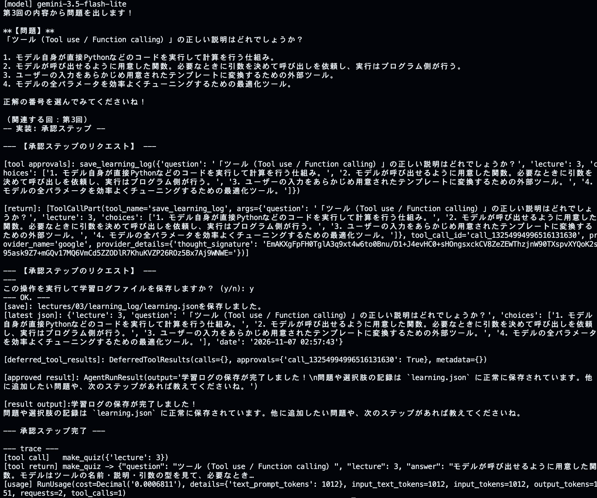
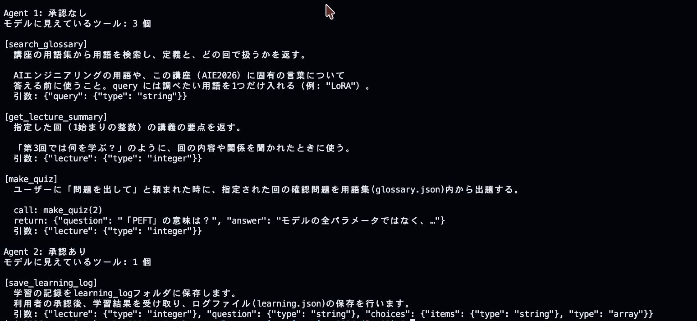

# 第3回 解答

## 演習

- 第1回（素のLLM）とエージェントの回答の違い：
#### [LLM]
	以下のように、LLMでは、おおむね同じような回答だが、時折、揺らぎがある。
```markdown
AIE2026の講座における「3レベル」とは、生成AIを活用する際の習熟度や段階（例えば、基礎・応用・実践など）を示す指標です。自身のスキルや目的に合わせ、段階的に学習を進めるための基準として設定されています。
```  
#### [agent]
	Agentでは、ツールの構造化を行なっているので、LLMの回答がより適切になってきている。プロンプト内容からLLMから返答する部分は、プロンプトをうまく理解できずに、ツールへの受け渡しが重なる部分もあるので、ループの中でツールにどのような責任を持たせるかを構造的に設計する必要性を感じた。
```markdown
$ uv run python -m app.agent "第３回の講義内容を教えてください。"
[model] gemini-3.5-flash-lite
「3レベル」とは、AIE2026の宿題の構成を示す言葉で、以下の3つの段階に分かれています。

1. **基礎**：講義内容の確認
2. **実装**：自分でコードを書く
3. **発展**：調査や試行

この3つのレベルのうち**どれか1つ**に取り組めば、その回の宿題は完了となります（原則として採点は行いません）。ご自身の理解度や目的に合わせて、取り組むレベルを選んでみてくださいね。

関連する回：第1回
```  

---
- `--trace` で見えたツール呼び出し（ツール名と引数）：
```markdown
$ uv run python -m app.agent --trace "LoRAとQLoRAの違いは？"
--- 
[agentからの出力]
[model] gemini-3.5-flash-lite
講座の用語集によると、LoRAとQLoRAの違いは以下のとおりです。

* **LoRA**
  事前学習済みの重みを固定したまま、重みの更新分を2つの小さな低ランク行列の積で表し、その小さな行列だけを学習するPEFT（Parameter-Efficient Fine-Tuning）手法です。学習パラメータや保存ファイルを少なく抑えられます。
* **QLoRA**
  ベースモデルの重みを4ビットなどに量子化（Quantization）してメモリを大きく節約したうえで、LoRAによる学習を行う手法です。これにより、より大きなモデルを小さなGPU環境でも扱えるようになります。

関係する回：第2回

--- trace ---
[tool call]   search_glossary({'query': 'LoRA'})
[tool call]   search_glossary({'query': 'QLoRA'})
[tool return] search_glossary -> [{"term": "LoRA", "lecture": 2, "definition": "事前学習済みの重みは固定したまま、重みの更新分を2つの小さな行列の積（低ランク行列）で表し、その小さな行列だけを学習するPEFT手法。学習するパラ…
[tool return] search_glossary -> [{"term": "QLoRA", "lecture": 2, "definition": "ベースモデルの重みを4ビットなどに量子化してメモリを節約したうえで、…
[usage] RunUsage(cost=Decimal('0.0008213'), details={'text_prompt_tokens': 1196}, input_text_tokens=1196, input_tokens=1196, output_tokens=185, requests=2, tool_calls=2)
```  
- 1つの質問での LLM 呼び出し回数（`requests`）：2
- 追加したツールと、docstring に書いた説明：
[追加したツール]: make_quiz  
[docstring]: 以下のとおりです。
```Python
# docstringにツール説明を行う。LLMはこのツールがなんであるかを知るために必須。
"""ユーザーに「第２回の確認問題を出して」と頼まれた時に、指定された回の確認問題を用語集(glossary.json)内から出題する。

call: make_quiz(2)
return: {"question": "「PEFT」の意味は？", "answer": "モデルの全パラメータではなく、…"}
"""
```
## 宿題:1

- 取り組んだレベル：**基礎**
- やったこと：
> makequizを作成、docstring/INTRUCTIONSの指示を変更することで、agentの動作にどのような影響があるかを確認しました。
- 結果：INSTRUCTIONSに確認問題と4つの選択肢の作成を指示したところ、agentは指示に従い、ツールから任意の確認問題と選択肢まで用意してくれました。

#### 最終結果  

| 変更前 | 変更後 |
| :---: | :---: |
|  |  |

- 気づき・疑問：
	- INTRUCTIONSで振る舞いを強く指示すれば、LLMは解釈を行いますが、必ずしも望んでいる回答になっていないと感じた。
	- プロンプトによる制御は、LLMが従うとは限らないので、別のアプローチによって根本的に解決を行わないとバグに繋がったり、原因が見つからないと言ったことになりそうだった。
	- LLMの自由度が高いので、指示の限定やクリティカルな指示も必要と感じます。疑問として、否定的な指示は、プロンプト内に増えてくると、どこまで解釈ができるのかは課題が残りました。
	- INTRUCTIONSは、振る舞いとして、適度な抽象的によるエージェントの性質を記述するとよいと感じます。ツールのdocstringは、結果によってどのような引数に引き継がれるかという説明を明示した方が次の指示を実行しやすいと感じました。

---
## 宿題:2
- 取り組んだレベル：**実装**
- やったこと：
> 学習記録保存として、learning_log/learning.jsonに保存をおこないました。保存する際、ユーザ承認フローを実装しました。また、ワークフローを単一エージェントと分割エージェントによってどのような動作の違いがあるかを試行しました。
- [単一エージェント]
	1. INSTRUCTIONSにmake_quiz, save_learning_logの実行をプロンプトとしてわたし、エージェントに実行させました。
	2. make_quizの指示では、承認指示を出さないプロンプトにしないとプロセスの優先度が同じく解釈され、承認フローが行われないといったことが起きました。また、agentの実行結果を得てから、同一エージェントのメッセージの履歴は、次の処理の際に引き継がないとLLMは次の指示を実行できませんでした。
- [分割エージェント]
	1. INSTRUCTIONSを共通とQUIZ, LOG用にわけ、エージェントを分割しました。プロンプトを明示して分けることができるので、別エージェントにQUIZでの結果を受け取り、承認フローへ引き継ぎ、ログへと保存しました。

#### 最終結果
**学習ログ**
```JSON
// learning_log/learning.json
{
    "title": "学習記録",
    "dir": "lectures/03/learning_log",
    "file": "lectures/03/learning_log/learning.json",
    "log": [
        {
            "lecture": 5,
            "question": "AIエンジニアリングにおいて最も適切な説明はどれですか？",
            "choices": [
                "1. 大規模言語モデルを一から自社で事前学習し、モデルの根本的なアーキテクチャを開発する技術領域",
                "2. 学習済みの基盤モデルを部品として使い、実際に役立つアプリケーションやシステムを設計・構築・評価・運用する技術領域",
                "3. パソコンのハードウェアやGPUの製造・保守を担当するハードウェアエンジニアリングの領域",
                "4. プログラミング言語のコンパイラを自作するための情報科学の領域"
            ],
            "date": "2026-11-07 03:23:00"
        }
    ]
}
```  
### [単一エージェント]
- 結果：INTRUCTIONSとプロンプトによって、make_quizを出した後に学習保存するかの承認フローまでを実装できました。
- 気づき・疑問：
	1. INTRUCTIONSの指示で、make_quizと学習記録保存を明示的に分けるよう指示しないと先に承認が行われるなど、動作がチグハグになってしまった。デバッグを進める中で、ワークフローの構造を決める中で、プロセスをどの指示をどの順番でどこまで完了するのかまとめる適切さが難しかったです。
	2. デバッグを通して、Agent動作の基本を実践でき、プロセスを複合的に行えることを実感しました。LLMの解釈性は、できる限り短く明確な答えの方が、指示として良いこともわかりました。
	3. 実装途中、承認処理やクイズが順番通りに動作せず、承認フローがスキップされるなどの問題が発生しました。これはメッセージ履歴を次の処理エージェントに追加していないことが原因でした。TOKEN制限にも繋がるので、履歴コンテキストの圧縮は次の課題として残りました。
	4. Agent開発を全てAPIに頼るのではなく、その他の小型ローカルAIの推論を部分的に利用する必要がでると感じました。その分複雑性も増し、APIに頼ればコスト面・TOKEN制限にすぐに引っかかりそうであり、トレードオフ部分が気になるところです。
	5. 実装を通じ、Agent開発では特にプロセス設計が重要だと感じました。機能要件の実装だけでなく、それぞれの機能を指示によってどのタイミングで実行し一つの処理として完了させるのかを考える必要がありました。今回のクイズと学習記録保存のように、機能ごとの実行範囲やユーザー承認を挟むタイミングを明確にしないと、意図しない順序で処理が進みます。プロンプトの指示で解決するのではなく、機能要件の分割や実行条件、状態を含めたプロセス全体を見直しながら、進めるのが、全体の最適化につながるのではないかとも感じました。

#### 実行結果
#### ツールリスト


#### ワークフロー
| 承認時 | 非承認時 |
| :---: | :---: |
|  |  |

#### コード
| INSTRUCTIONS(修正前) | 動作検証(修正前) | 
| :---: | :---: | 
|  |  | 

#### デバッグ
> 1. INSTRUCTIONSでのツールへの順番がQUIZと学習ログで混合してしまい、Agentが一緒に処理してしまうため、承認プロセスが先になってしまう。
> 2. QUIZの出題後に、学習記録保存のプロセス承認が自然なワークフローと考えたため、ワークフローの調整を行いました。


### [分割エージェント]
- 結果：エージェントを分割し、それぞれのエージェントが一つの作業を担当するので、LLMの迷いは少ないと感じました。一方で定性的な判断として処理の体感速度は単一エージェントより長く感じました。
- 気づき・疑問：
	- エージェントを分割すると、エージェントからみてもワークフローの確実性が増し、単一エージェントでの一括処理を行う。承認フローを飛ばすと言ったことがなくなりました。
	- 分割したことによって、再度モデルへのアクセスが発生するので、回答までのレスポンスが単一エージェントより体感速度が悪くなった。
	- 分割前に比べ、エージェントの取違やコードの冗長化などが課題として残りました。

#### 実行結果


#### ツールリスト



### [全体]
- 分割エージェントで行った方が、任せる作業をシンプルにでき、エージェント設計では単一原則の原則として、構造化に関して難しさを感じながらも、魅力を感じました。
- どちらを選ぶかは、ワークフローによって使い分けをすべきであり、単純にプロンプトによる解決を促すか、分かるのかは、LLMの解釈の揺らぎを考慮して結果や処理内容の正確性やコストによってもトレードオフが必要と感じました。
- 大きく二つのエージェント実験を通して、ワークフローの適切なフロー設計がエージェント開発では求められるということが実感できました。
- 一つのエージェントの結果も想定しながら、開発を進めないとバグが発生した際に原因を取り違える可能性もあると考えました。
- LLMは「何でもできそう」という感覚に陥りがちですが、「いつ・どこで・何をするのか」という基本的なプロセス設計の思考に戻ることを、面倒くさがらずにしていきたいと思います。