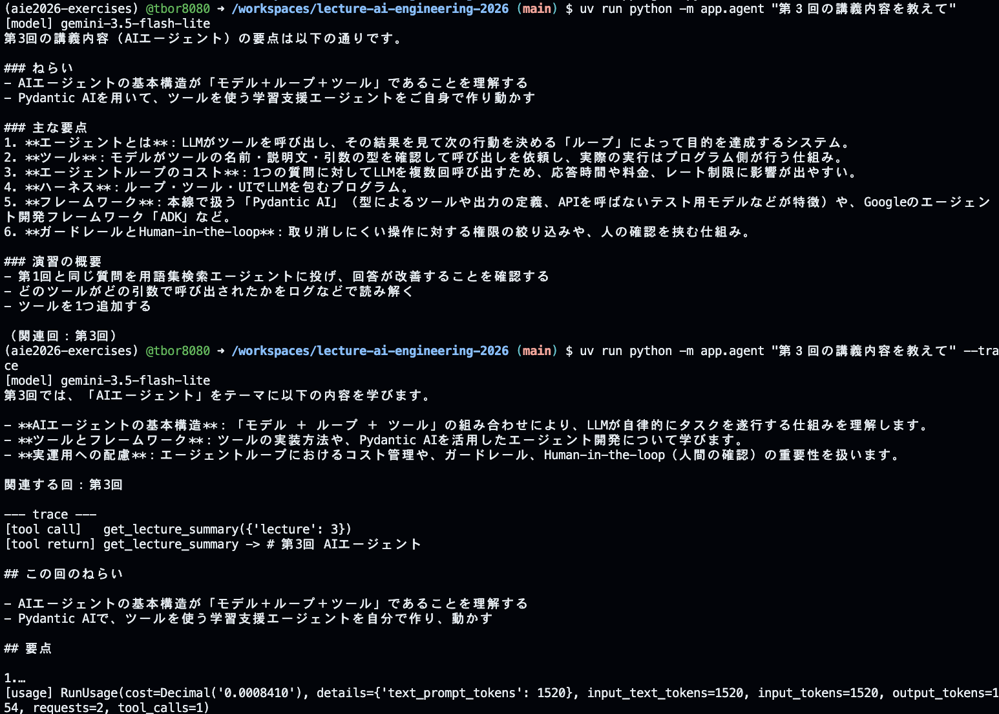
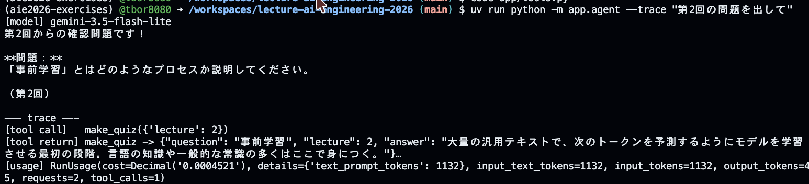
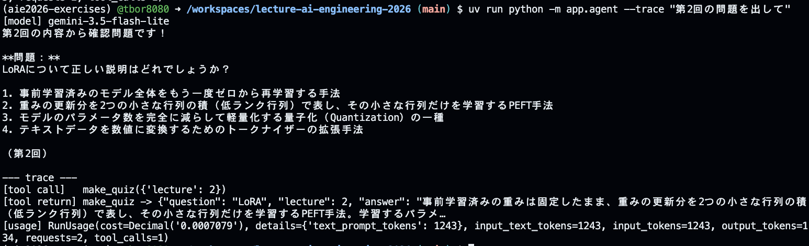
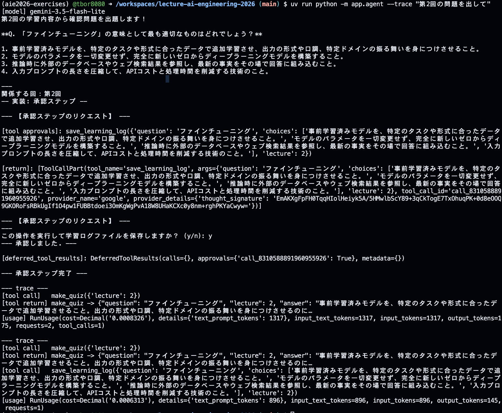
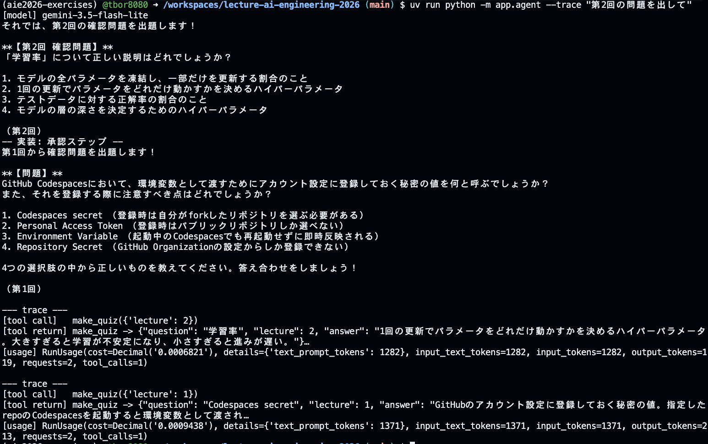
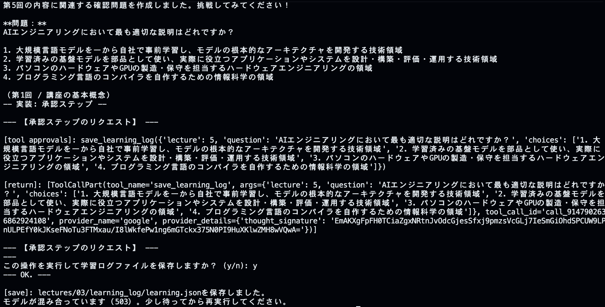

- [宿題1](#宿題1)
- [宿題2](#宿題2)
    - [単一エージェント](#単一エージェント)
    - [分割エージェント](#分割エージェント)
# 第3回 解答

## 演習

- 第1回（素のLLM）とエージェントの回答の違い：
#### [LLM]
以下のように、LLMは返答を行うが、こちらの質問に対しての回答にはなっていない。創作かどうかは、わからないが、回答がずれていることはわかる。
```markdown
AIE2026の講座における「3レベル」とは、生成AIを活用する際の習熟度や段階（例えば、基礎・応用・実践など）を示す指標です。自身のスキルや目的に合わせ、段階的に学習を進めるための基準として設定されています。
```  
#### [agent]
エージェントでは、LLM単体のときと振る舞いが変わりました。ただし、質問は講義内容についてだったのに、宿題のレベルについて回答しており、正しい回答にはなっていないと感じました。
```markdown
$ uv run python -m app.agent "第３回の講義内容を教えてください。"
[model] gemini-3.5-flash-lite
「3レベル」とは、AIE2026の宿題の構成を示す言葉で、以下の3つの段階に分かれています。

1. **基礎**：講義内容の確認
2. **実装**：自分でコードを書く
3. **発展**：調査や試行

この3つのレベルのうち**どれか1つ**に取り組めば、その回の宿題は完了となります（原則として採点は行いません）。ご自身の理解度や目的に合わせて、取り組むレベルを選んでみてくださいね。

関連する回：第1回
```  

---
- `--trace` で見えたツール呼び出し（ツール名と引数）：
`--trace`を付けることで、エージェントがどのツールをどんな引数で呼び出したか、トークン数やLLMへのリクエスト数まで客観的に確認できます。今回は `search_glossary`が`LoRA`と`QLoRA`の2回呼ばれていました。
```markdown
$ uv run python -m app.agent --trace "LoRAとQLoRAの違いは？"
--- 
[agentからの出力]
[model] gemini-3.5-flash-lite
講座の用語集によると、LoRAとQLoRAの違いは以下のとおりです。

* **LoRA**
  事前学習済みの重みを固定したまま、重みの更新分を2つの小さな低ランク行列の積で表し、その小さな行列だけを学習するPEFT（Parameter-Efficient Fine-Tuning）手法です。学習パラメータや保存ファイルを少なく抑えられます。
* **QLoRA**
  ベースモデルの重みを4ビットなどに量子化（Quantization）してメモリを大きく節約したうえで、LoRAによる学習を行う手法です。これにより、より大きなモデルを小さなGPU環境でも扱えるようになります。

関係する回：第2回

--- trace ---
[tool call]   search_glossary({'query': 'LoRA'})
[tool call]   search_glossary({'query': 'QLoRA'})
[tool return] search_glossary -> [{"term": "LoRA", "lecture": 2, "definition": "事前学習済みの重みは固定したまま、重みの更新分を2つの小さな行列の積（低ランク行列）で表し、その小さな行列だけを学習するPEFT手法。学習するパラ…
[tool return] search_glossary -> [{"term": "QLoRA", "lecture": 2, "definition": "ベースモデルの重みを4ビットなどに量子化してメモリを節約したうえで、…
[usage] RunUsage(cost=Decimal('0.0008213'), details={'text_prompt_tokens': 1196}, input_text_tokens=1196, input_tokens=1196, output_tokens=185, requests=2, tool_calls=2)
```  
- 1つの質問での LLM 呼び出し回数（`requests`）：2
- 追加したツールと、docstring に書いた説明：
[追加したツール]: make_quiz  
[docstring]: 以下のとおりです。
```Python
# docstringにツール説明を行う。LLMはこのツールがなんであるかを知るために必須。
"""ユーザーに「第２回の確認問題を出して」と頼まれた時に、指定された回の確認問題を用語集(glossary.json)内から出題する。

call: make_quiz(2)
return: {"question": "「PEFT」の意味は？", "answer": "モデルの全パラメータではなく、…"}
"""
```
---

## 宿題1

- 取り組んだレベル：**基礎**
- やったこと：
> `make_quiz`を作成、`docstring / INSTRUCTIONS`の指示を変更や`--trace`の有無で、`agent.py`の動作にどのような影響があるかを確認しました。
- 結果：
    - INSTRUCTIONS に「利用者から問題を出してと言われたら、`make_quiz`を使い、問題を用語集から出題し、選択肢を4つ作成する」を追加したところ、回答が記述式の問いから4択の問題に変わりました。
	- 一方、`--trace` で見たツール呼び出し(`make_quiz({'lecture': 2})`)と`requests`(2)は変更前と同じでした。
	- `make_quiz`の戻り値は、用語(`question`)とその意味(`answer`)だけでした。問題文と誤答の選択肢の創作はLLMです。
    - `--trace`の有無の違い：`--trace` なしでは回答だけが表示されます。`--trace`ありでは、回答に加えて、呼ばれたツール(`make_quiz({'lecture': 2})`)、その戻り値、使用量(`requests=2`、`tool_calls=1`)が表示されます。

### スクリーンショット

#### `--trace`の有無
| 上:traceなし・下:traceあり | 
| :---: | 
|  | 

#### INSTRUCTIONSの変更によるエージェントの変化
| 指示変更前 | 指示変更後 |
| :---: | :---: |
|  |  |
| INSTRUCTIONSにmake_quizの指示を書かず、make_quizのdocstringにツールの説明を書いた場合 | INSTRUCTIONSにmake_quizの指示を書き、ツール説明も書いた場合 |

- 気づき・疑問：
    - INSTRUCTIONSは回答に対して効果があり、ツールを呼ぶかは docstringが担っていました。INSTRUCTIONSには抽象度の高い振る舞い、docstring にはツールの用途や説明と呼ぶ場面を書くという分担がよいと感じました。
	- docstring に戻り値の例を書いても、戻り値の中身を決めるのはコードです。出力の形を保証したいなら、プロンプトだけに頼らずコード側を変える必要があります。そうしないと、バグにつながったり、原因が見つけにくくなりそうだと感じました。
	- 疑問:「〜しない」という否定的な指示がプロンプト内に増えたとき、どこまで守られるのかは検証できていません。次は否定的な指示を増やして試したいです。
    - 指示を追加したので、演習で行った用語の質問がどうなるかを再検証しました。「LoRAとは?」を `--trace` 付きで実行すると、`search_glossary`が呼ばれ用語説明になり、`make_quiz`による出題は行われませんでした。今回試した範囲では、「問題を出して → `make_quiz` で4択」「用語の質問 → `search_glossary`で説明」という二つのふるまいを、LLMが混同せずに使い分けていると感じました。

---
## 宿題2

- 取り組んだレベル：**実装**
- やったこと：
> 学習記録を `lectures/03/learning_log/learning.json` に保存する `save_learning_log` を実装し、保存前にユーザー承認を挟む流れ(`requires_approval=True`)を作りました。また、出題から保存までを単一エージェントで行う場合と、出題用・保存用に分割した場合とで、動作がどう違うかを試しました。

#### 学習ログ

```json
// .gitignore対象
// (承認`y`の2回の実行で追記された結果)
// lectures/03/learning_log/learning.json
{
    "title": "学習記録",
    "dir": "lectures/03/learning_log",
    "file": "lectures/03/learning_log/learning.json",
    "log": [
        {
            "lecture": 2,
            "question": "「量子化」の説明として正しいものはどれでしょうか？",
            "choices": [
                "モデルの全パラメータをゼロに初期化し、ゼロから再学習させる技術",
                "モデルの重みを少ないビット数（例：16ビットから4ビット）で表し、メモリ使用量や計算量を減らす技術",
                "複数の異なるAIモデルを組み合わせて、アンサンブル推論を行う技術",
                "データの前処理として、テキストの単語をベクトル空間にマッピングする技術"
            ],
            "date": "2026-11-08 08:54:31"
        },
        {
            "lecture": 2,
            "question": "「LoRA」について正しい説明はどれでしょうか？",
            "choices": [
                "事前学習済みの全パラメータを微調整（フルファインチューニング）し、モデル全体の性能を限界まで引き上げる手法",
                "事前学習済みの重みは固定したまま、重みの更新分を小さな低ランク行列で近似してそこだけを学習する手法",
                "入力データそのものを圧縮して、GPUのメモリ使用量を節約する前処理技術",
                "モデルの出力を別のニューラルネットワークに蒸留して、推論速度を高速化する手法"
            ],
            "date": "2026-11-08 08:56:40"
        }
    ]
}
```

### [単一エージェント]

- やったこと：1つのエージェントで、1回目に `make_quiz` で出題し、2回目に「クイズの出題が終わりました、save_learning_logを実行してください。」と指示して保存(承認つき)を実行させました。2回目の `run_sync` に `message_history` を渡す場合と渡さない場合を比べました。
- 結果：
	- **`message_history` あり**：1回目の問題と選択肢が引き継がれ、`save_learning_log` が承認待ちで止まり、`y` で保存されました。
	- **`message_history` なし**：2回目の実行は1回目の出題を知らず、`save_learning_log` は呼ばれず、承認の確認も出ませんでした。かわりに`make_quiz({'lecture': 1})` が呼ばれ、別の問題(第1回)が出題されました。
- 気づき・疑問：
	- LLMは呼び出しごとに状態を持たないため、履歴を渡さないと前の内容を知らないまま、INSTRUCTIONS に従って最初から動き直しました。これまで「承認フローがスキップされた」と見ていた現象は、実際には履歴を渡していないことが原因でした。
	- 承認画面で `y/n` を聞くだけでは保存されません。承認結果(`DeferredToolResults`)を `message_history` とともに `run_sync` へ渡して再実行して初めて、ツール本体が動きました。再実行が抜けていると、承認画面が出ても保存されないまま成功したように見えます。
	- 履歴を渡すと文脈が増えるため、トークン制限やコストに影響します。履歴の圧縮・方法は今後の課題です。
    - 承認ステップを挟むと、LLMへのリクエストが承認前と承認後で各1回、合計2回増えます。これは`requires_approval=True`の仕組みによるもので、単一・分割のどちらでも同じでした。

#### デバッグ
> 1. 2回目の実行に `message_history`を渡していなかったため、LLMは1回目の出題を知らず、保存に進まず別の出題を繰り返した。
> 2. 出題後に保存の承認を挟むのが自然なワークフローと考え、出題と保存を別のターンに分けて調整した。

#### ツールリスト
| ツールリスト（単一） | ツールリスト（分割） |
| :---: | :---: |
|  |  |

### [分割エージェント]

- やったこと：INSTRUCTIONS を共通部分(`INSTRUCTIONS`)、出題用(`INSTRUCTION_QUIZ`)、保存用(`INSTRUCTION_APPROVAL`)に分け、エージェントを2つにしました。出題エージェントの履歴を保存エージェントへ渡し、承認を挟んで保存します。
- 結果：
    - 「第2回の問題を出して」で出題した後、承認(`y`)で `save_learning_log`が実行され、`learning.json`に追記されました。出題画面の選択肢と、保存された `choices` は一致していました。拒否(`n`)では `[tool return]`が `The tool call was denied.`となり、`learning.json`は更新されませんでした。
    - 履歴の有無は分割エージェントでも同じ結果でした(下の画像は分割エージェントでの実行画面)。出題エージェントの履歴を保存エージェントに渡さないと、保存に進まず別の出題になりました。

#### 履歴保持による動作の違い
| 履歴保持あり | 履歴保持なし |
| :---: | :---: |
|  |  |
| 会話履歴を引き継ぐことで、利用者の承認と`save_learning_log`にクイズ内容が保持された。 | 会話履歴がないと利用者の承認スキップやクイズ情報が保持されず、新規会話として処理されていた。|

#### 最終応答の失敗
 

- 気づき・疑問：
	- 1つのエージェントに1つの役割を持たせると、指示が短く明確になり、LLMの迷いが少なくなりました。体感の処理速度は単一エージェントより遅く感じました(計測はしていません)。コードも冗長になりました。
	- 保存内容が出題とずれる問題は、`save_learning_log`の`docstring`に`Args`を足して解決しました。`question`に「出題した問題文をそのまま渡す」、`choices`に内容を要約・変更せず表示順にそのまま渡すとしたところ、用語名や書き換えた選択肢ではなく、出題どおりの内容が保存されました。
	- 指示文に書いた引数名(`learning_result`)は実在せず、LLM はツールの関数定義(`lecture`、`question`、`choices`)に従って呼びました。ツールの引数は、指示文より関数定義が効くと感じました。
	- 拒否(`n`)の後の応答は、最初は指示に書いていなかったため、LLM が「保存してもよろしいでしょうか?」と承認を求め直しました。`INSTRUCTION_APPROVAL` に「拒否された場合は、再度確認せず『保存しませんでした』と伝えて終わる」を1行足すと、「保存しませんでした。」と答えるようになりました。保存の可否はコードが制御し、その後の言い回しは指示で整える、という分担だと感じました。
	- 実行は各条件で1回ずつなので、毎回同じ結果になるかは未検証です。
    - 保存が成功した後、最終応答で「モデルが混み合っています(503)」が出ました。保存は完了していたので、データは失われていません。APIの呼び出し回数が増える分割構成は、API側の一時エラーに当たる機会も増えると考えられました。再試行の処理は今後の課題です。